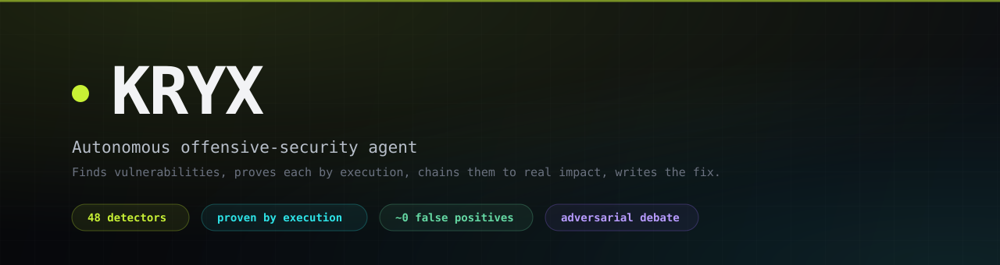
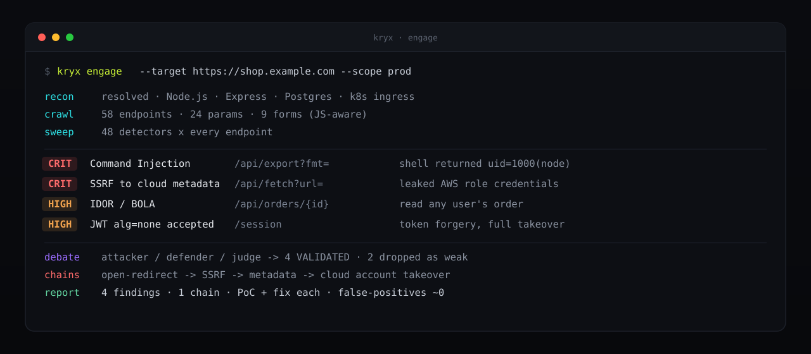
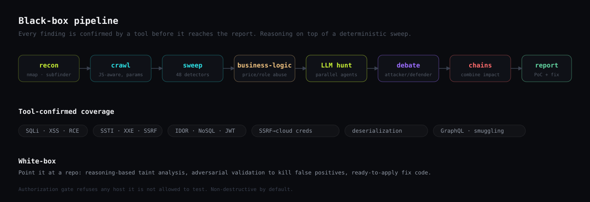

<div align="center">



<br/>


**Autonomous offensive-security agent.**
Finds vulnerabilities, **proves** each one by execution, chains them to real impact, and writes the fix,
across live web apps and source code. Reasoning where scanners are blind, low-noise where scanners are loud.

</div>



---

## The problem

Scanners are loud and shallow: they flag *possible* issues and drown you in false positives, and they cannot reason about business logic. Manual pentesting is deep but slow and does not scale. Kryx sits in between - it reasons like a pentester and confirms like a scanner, so what lands in the report is small, real, and already proven.

---

## Why Kryx

| | |
|---|---|
| **Proof, not noise** | Every finding is reproduced by a tool. No working proof, no report line. |
| **Near-zero false positives** | A visible attacker/defender/judge debate kills weak findings before you see them. |
| **Safe on production** | Non-destructive by default, hard limits, and a domain-ownership gate that refuses any host you are not authorized to test. |
| **Reasoning + coverage** | A deterministic sweep of 48 detectors, then parallel LLM agents that chain findings into real impact. |

---

## What it does



### Black-box, live targets
A deterministic pipeline maps the real attack surface and confirms every vuln with a tool, so findings are proven, not guessed:

```
recon -> crawl (JS-aware) -> sweep (every detector on every endpoint) -> business-logic
      -> LLM hunt -> adversarial debate (verify) -> attack-chains -> report
```

**Tool-confirmed classes (48 detectors):**

- **Injection** SQLi · command injection (RCE) · SSTI · NoSQL · XXE · LDAP · XPath · SSI
- **Access & auth** IDOR/BOLA · JWT (alg=none, weak secret) · host-header / reset poisoning
- **Server-side** SSRF (out-of-band) · **SSRF -> cloud metadata -> credentials** · insecure deserialization · prototype pollution · insecure file upload
- **Client-side** XSS (reflected/stored/DOM) · CSRF · clickjacking · open redirect · CORS
- **Exposure** secrets/configs · `.git`/`.svn` · management panels (actuator, phpMyAdmin, Jenkins) · GraphQL introspection
- **Protocol** HTTP request smuggling · CRLF / header injection · parameter pollution · WebSocket hijacking
- **Robustness** resource-exhaustion / unbounded input (non-destructive) · known CVEs & exposures (nuclei)

**Business-logic flaws** scanners can't find: negative price/quantity, price and role tampering, broken object-level access, confirmed by the server's own response.

**Visible adversarial debate:** an attacker argues a finding is real, a defender attacks it, a judge rules, before it reaches the report.

Every finding ships a **proof-of-concept and a ready-to-apply fix**.

### White-box, source code
Point it at a repo or path: reasoning-based taint analysis, an adversarial validation pass to kill false positives, and ready-to-apply fix code.

### Autonomous mode
Discovers authorized targets (bug-bounty scopes, OSS repos) and audits them, behind a hard **authorization gate** that refuses any host it isn't allowed to test.

---

## Sample run

```text
$ python run_scan.py https://your-authorized-target

[recon]   target -> 34.202.86.158  (Node.js · Express · React/Vite · k8s ingress)
[crawl]   41 endpoints · 18 params · 6 forms
[sweep]   nuclei: /config.json leaks API keys                       [CRITICAL]
[hunt]    [injection]  cmdi /api/spawn?command= -> remote shell      [CRITICAL]
[hunt]    [auth]       jwt alg=none accepted -> token forgery        [HIGH]
[hunt]    [ssrf]       /api/file?url= -> 169.254.169.254 (AWS)       [CRITICAL]
[debate]  attacker / defender / judge -> VALIDATED (reproduced x20)
[chains]  open-redirect -> ssrf -> metadata -> cloud takeover
[report]  6 findings · 2 chains · every one proven

RESULT    critical 3 · high 1 · medium 2 · false-positives ~0
```

### A finding, in full

Every finding ships proof and a fix, not a guess:

```text
[CRITICAL]  Command Injection · /api/spawn
CVSS 9.8 · CWE-78 · confirmed by execution

Proof:    GET /api/spawn?command=id
          -> uid=1000(node) gid=1000(node)          # a shell came back
Impact:   arbitrary commands as the app user; pivot to cloud creds via SSRF
Fix:      never pass user input to a shell; use execFile with a fixed argv allow-list
```

---

## How the debate works

A finding does not reach you because one agent believed it. Every candidate goes through a short adversarial round:

- **Attacker** states the vulnerability and the exact request that triggers it.
- **Defender** attacks that claim - wrong context, sanitized sink, unreachable code, benign reflection.
- **Judge** rules on the evidence and the tool result, and only a survivor is reported.

This is the layer that kills the false positives scanners can't, and it is why a Kryx report is short.

---

## Design principles

- **Proof or it doesn't ship.** No finding is reported without a tool reproducing it. A claim without a working proof is dropped, not downgraded.
- **Non-destructive by default.** Aggressive and resource-exhaustion checks are bounded and off unless you explicitly opt in. Kryx is built to run against production without breaking it.
- **Authorization first.** Every active scan passes a hard gate; unauthorized hosts are refused, and the gate is covered by tests.
- **Reasoning on top of determinism.** A deterministic 48-detector sweep guarantees coverage; parallel LLM agents add the reasoning and the chains that turn findings into real impact.
- **A fix with every finding.** Each report line ships a proof-of-concept and ready-to-apply remediation, not just a severity label.

---

## Where it fits

- **Continuous testing** of your own apps and APIs between pentests.
- **Pre-release gate** in CI - point it at a staging URL or a pull request.
- **Bug-bounty and OSS auditing** within authorized scopes.
- **Source-code review** on any repo or path, with taint analysis and fix code.

---

## Repository layout

```
kryx/
├── backend/                 # the engine + SaaS API
│   ├── core/
│   │   ├── harness/         # pipeline: crawler · sweep · hunter · debate · chains · reporter · code_auditor
│   │   ├── tools/           # deterministic detectors (scanner.py + probes_ext.py: 48 checks)
│   │   ├── agents/          # LLM prompts
│   │   └── autonomous/      # authorization gate + target discovery
│   ├── api/                 # FastAPI SaaS routes (auth · scans · history)
│   ├── billing/             # Stripe integration
│   ├── integrations/        # GitHub / GitLab webhooks
│   ├── testbed/             # intentionally-vulnerable app for local testing
│   ├── tests/               # pytest suite (authz gate · dedup · pipeline dispatch)
│   ├── run_scan.py          # CLI runner
│   └── main.py              # SaaS API entrypoint
├── frontend/                # React product UI (self-serve dashboard)
├── docs/                    # architecture · database · integrations · coverage matrix
└── assets/                  # brand + diagrams
```

---

## Quick start

```bash
cd backend
python -m venv venv && source venv/bin/activate
pip install -r requirements.txt
playwright install chromium          # for the JS-aware crawl / DOM XSS

cp .env.example .env                 # set KRYX_MODEL + OPENROUTER_API_KEY

# scan a target (authorized only)
python run_scan.py https://your-authorized-target
```

For known-CVE coverage, install [nuclei](https://github.com/projectdiscovery/nuclei) and make sure it's on `PATH`.

### Tests

```bash
cd backend && ./venv/bin/python -m pytest tests/ -q
```

---

## Configuration (`backend/.env`)

| Var | Purpose |
|-----|---------|
| `OPENROUTER_API_KEY` | LLM provider key |
| `KRYX_MODEL` | reasoning model |
| `KRYX_HUNTERS` | parallel LLM hunters (default 8) |
| `OPENROUTER_MAX_TOKENS` | output cap per call (default 8000) |
| `KRYX_RESOURCE_AGGRESSIVE` | `1` to allow larger resource-exhaustion payloads (explicit consent) |
| `KRYX_NUCLEI` | set `0` to skip the nuclei stage |

---

## Authorization & safety

Kryx **only** actively scans hosts that are local/lab, listed in
`backend/core/autonomous/authorized_scopes.txt`, or in a fetched bug-bounty scope
whose program permits automated testing. Everything else is refused, and the gate is
covered by tests. Aggressive / resource-exhaustion checks are non-destructive by
default and require an explicit opt-in. **Only test what you are authorized to test.**

---

## Docs

- [Architecture](docs/ARCHITECTURE.md)
- [Coverage matrix](docs/coverage-matrix.md)
- [Database](docs/DATABASE.md)
- [Integrations](docs/INTEGRATIONS.md)

---

© Kryx, proprietary. All rights reserved. See [LICENSE](LICENSE).
